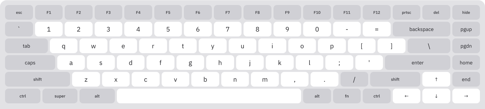

<div align="center">

# Touch Board

**The real on-screen keyboard for GNOME Shell.**<br>
_all **keys**, any **layout**, raw **input**_

**`layout profiles`** **`display scaling`** **`smart visibility`** **`evdev injection`** **`xkb tracking`** **`accent popups`** **`modifier modes`** **`fn layer`**

[](https://github.com/d3z-the-dev/touch-board/actions/workflows/ci.yml)
[](https://github.com/d3z-the-dev/touch-board/releases/latest)
[](https://extensions.gnome.org/extension/10302/touch-board/)

[](LICENSE)


</div>

>The stock OSK covers a search box and a password field. Touch Board is a full keyboard for writing, coding, and anything that needs working modifier keys, proper layout support and hardware-level evdev input.

## Highlights

- **Every key a hardware keyboard has.** Modifiers, function row, navigation, arrows and a numpad, sized for fingers.
- **Hardware-level input.** Keys inject raw evdev codes through a Clutter virtual device, and the active xkb layout translates them, so shortcuts and terminal apps behave as with a real keyboard.
- **Three profiles.** Compact (60%), Standard (75%) and Full (100%) fill the display width.
- **Modifier modes.** Shift, Ctrl, Alt, Super, AltGr and Fn work as Hold, Latch or Toggle.
- **Fn layer and remappable F-row.** Fn brings back what compact drops and turns the F-row into media keys. Each F-key can be remapped.
- **Live layouts.** Faces follow the active input source: 11 bundled glyph maps, CJK through IBus engines.
- **Accent popups.** Long-press a Latin letter for its variants.
- **Smart visibility.** A finger or pen tap on a text field opens it, a mouse click does not, typing on a hardware keyboard closes it.
- **Window lift.** The focused window moves up so the caret stays visible.
- **Two styles.** Modern follows the system light or dark scheme and accent colour. Classic keeps the original dark look.

## Profiles

<details>
<summary><b>Compact (60%)</b>: the ANSI main block, nothing else</summary>


The Fn layer brings back the rest.
</details>

<details>
<summary><b>Standard (75%)</b>: main block, F-row, navigation and arrows</summary>


Adds the function row, a navigation column (PgUp, PgDn, Home, End) and an arrow cluster. The default profile.
</details>

<details>
<summary><b>Full (100%)</b>: everything, plus a numpad</summary>


Standard plus an Ins/Home/PgUp over Del/End/PgDn block, PrtSc, ScrollLock and Pause with a media trio across the top, and a numpad with digit and navigation faces.
</details>

## Styles

>Modern is the default and follows the system colour scheme. Classic keeps the look of earlier versions.

<details>
<summary><b>Dark</b>: modern flat keys in the dark colour scheme</summary>


One-shot modifiers get an outline in the accent colour, locked ones a fill.
</details>

<details>
<summary><b>Light</b>: modern flat keys when the system prefers light</summary>



Same accent outline and fill as Dark.
</details>

<details>
<summary><b>Classic</b>: the original dark keyboard with gradient keys</summary>


One-shot modifiers fill with the accent colour, locked ones add a white ring. Classic stays dark in both colour schemes.
</details>

## Install

> [!IMPORTANT]
> Touch Board needs **GNOME Shell 46-50**. On Wayland the shell loads a newly installed or updated copy only after you log out and back in.

### extensions.gnome.org

Install [Touch Board](https://extensions.gnome.org/extension/10302/touch-board/) from extensions.gnome.org and toggle it on. This is the recommended route and brings automatic updates.

### From a release

Download `touch-board@d3z-the-dev.github.io.shell-extension.zip` from the [latest release](https://github.com/d3z-the-dev/touch-board/releases/latest), then:

```sh
gnome-extensions install --force touch-board@d3z-the-dev.github.io.shell-extension.zip   # --force replaces an older copy
gnome-extensions enable touch-board@d3z-the-dev.github.io   # switch it on
```

### From source

```sh
make install
```

Copies `src/` into your user extensions directory, compiles the schema, and enables the extension.

```sh
make uninstall   # disable and remove
make enable      # enable an installed copy
make pack        # build the zip in dist/
```

## Keys

### Modifiers

A modifier engages on lift. While engaged it wraps each keystroke (press modifier, tap key, release modifier), then drops one-shots and keeps locks.

| Mode   | Tap | Long press | Tap while engaged |
|--------|-----|------------|-------------------|
| Hold   | One keystroke | Locks across keys | Clears the lock |
| Latch  | Arms a one-shot for the next keystroke | (none) | A second tap within the double-tap window locks, a later one clears |
| Toggle | Flips a lock | (none) | Flips it off |

Latch is the default. Glyph keys preview the next level under an armed Shift or AltGr. Caps Lock mirrors the system keymap, hardware toggles included.

> [!NOTE]
> Hiding the keyboard clears every modifier and the Fn layer, locks included.

### Fn layer

Fn swaps the face and code of the keys it covers and injects nothing itself. It follows the modifier mode.

- **Compact:** F1-F12 on the number row, grave/tilde on Esc, navigation and arrows on `U I O P` / `J K L ;`, forward Delete on Backspace.
- **Standard and Full:** F1-F12 become a media row: brightness, overview, search, keyboard backlight, transport and volume.

Each F1-F12 slot can be remapped in Preferences to volume, brightness, media, mic mute, navigation or editing keys. A remapped slot wins over Fn.

### Numpad

Full profile only. Each key has a digit face and a navigation face. The Num key on the keyboard flips between them, independent of the system Num Lock, and the choice survives a hide.

### Accents

Long-press one of 12 Latin letters for its variants (50+ diacritics and symbols). Slide to a variant and release, or lift and tap. The variant replaces the letter typed on press. With accent popups off, a held key auto-repeats at the desktop rate instead.

## Layouts

Key faces follow the active input source. Glyph maps only choose the face. The xkb layout decides the character, so a source without a map shows US faces and still types correctly.

| Layout       | Code |
|--------------|------|
| English (US) | `us` |
| English (UK) | `gb` |
| German       | `de` |
| French       | `fr` |
| Spanish      | `es` |
| Italian      | `it` |
| Portuguese   | `pt` |
| Czech        | `cz` |
| Polish       | `pl` |
| Ukrainian    | `ua` |
| Russian      | `ru` |

CJK sources compose through an IBus engine (GNOME may report them as `cn` `jp` `kr`):

| Layout   | Code | Mode | Engine |
|----------|------|------|--------|
| Chinese  | `zh` | 拼   | Pinyin |
| Japanese | `ja` | あ   | Anthy  |
| Korean   | `ko` | 한   | Hangul |

With an engine active, keys go through `handleVirtualKey` instead of evdev. `ja` and `zh` keys show Latin caps for romaji and pinyin, `ko` keys show Dubeolsik jamo. Ctrl, Alt and Super bypass the engine.

> [!NOTE]
> The engines are installed separately. Without one, CJK sources fall back to US faces and US-position keysyms.

## Showing and hiding

A finger or pen tap on a text field opens the keyboard:

- **Apps:** fields that request an on-screen keyboard through text-input-v3 (GTK 3 and 4, Qt).
- **Shell:** overview search, dialogs and the lock-screen password.

A mouse or touchpad click does not open it, and neither does a tap beside a field or a field that takes focus by itself.

It closes on:

- **Hide key or panel button.** Tap a field to bring it back.
- **Focus loss.** Only when a tap opened it. Opened from the panel button, it stays up.
- **Hardware keyboard.** The first key from a USB or Bluetooth keyboard that edits the field or moves the caret. Power, volume and brightness buttons don't count, and neither does switching the layout with Super+Space.

While it is up, the focused window moves up by the keyboard height if the keyboard would cover the caret. Dragging the window cancels the lift.

> [!TIP]
> The panel button opens the keyboard anywhere, the lock screen included, and keeps it up until you close it. With **Screen Keyboard** on in the Accessibility settings, mouse clicks open it too, and Touch Board stands in for the GNOME keyboard.

## Preferences

Open them from the Extensions app or with `gnome-extensions prefs touch-board@d3z-the-dev.github.io`.

| Setting | What it does |
|---|---|
| Layout | Compact, Standard or Full |
| Style | Modern (follows the light or dark scheme) or Classic (dark, shaded keys) |
| Height | Percent of the shorter display edge, 18-60 |
| Key spacing, Font size | Percent of the default (font size 75-135) |
| Key font | Any installed family (the clear button goes back to IBM Plex Sans, or to the interface font without it) |
| Label case | Upper, title or lower (F1-F12 keep their capital F) |
| Key corners | Sharp, soft or round |
| Keyboard corners | Round or square top corners |
| System accent colour, Engaged colour | Modifier colour: the GNOME accent (blue on GNOME 46) or a custom colour |
| Modifier keys | Hold, Latch or Toggle |
| Accent popup | Long-press for accents, or auto-repeat |
| Key click | One click per key press: thock, click or tap, with volume |
| Function row | Remap any F1-F12 slot |

> [!WARNING]
> Coming from 0.1.5 or older, your settings may still hold the old grey engaged colour and an explicit IBM Plex Sans. Turn on **System accent colour** and press the font clear button to get the new defaults.

## Development

`src/` runs as plain GJS with no build step.

```sh
git clone https://github.com/d3z-the-dev/touch-board
cd touch-board
npm install      # dev tools (eslint)
make lint        # run eslint
make pack        # build the zip in dist/
```

## Contributing

Open an issue or a pull request and state the scope up front.

### Features

- **Missing functionality:** something the stock OSK or a comparable keyboard does and Touch Board does not. Say where it exists and why it belongs here.
- **New functionality:** anything that fits a full hardware keyboard on a touchscreen. Describe the use case.
- **New input types:** gesture typing, handwriting forwarded to IBus, a stylus layout. Bring a working prototype or a tight spec.
- **Larger ideas:** experimental or high-effort features. Open the issue as a proposal with the full use case and, if you have one, a proof-of-concept fork. Work starts after a maintainer decision.
- **New layouts:** any xkb layout not in the shipped set, in the format of `src/lib/labels.js`, with a verified glyph map and a reference (keyboard photo or xkb file). Building the maps from the active xkb layout at runtime is welcome too.

### Bugs

> [!IMPORTANT]
> Include exact steps from a fresh GNOME session, expected and actual behaviour, GNOME Shell version, Wayland or X11, device model, screen resolution and scaling factor.

- **CJK layouts** (`zh` `ja` `ko`): the keyboard only forwards keysyms and leaves composition to the IBus engine. Give the engine name, version and custom settings, and say whether the bug shows with and without an active engine.
- **Display, scaling, rendering:** add the monitor count, whether it reproduces after a rotation or on a secondary display, and a screenshot or recording.

> [!CAUTION]
> Issues and pull requests that leave out the details above are closed without review. A bug report needs steps that reproduce it from a fresh session. A pull request also needs a passing `make lint` and a record of how it was tested: GNOME Shell versions, Wayland or X11, and what was checked on the device.

## License

Touch Board ships under GPL-3.0-or-later. See [LICENSE](LICENSE) for the full text.

The documentation images in `docs/img/` are licensed under [CC-BY-SA-4.0](LICENSES/CC-BY-SA-4.0.txt).
