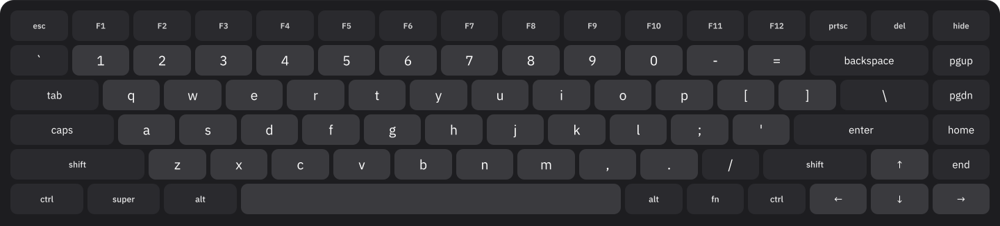
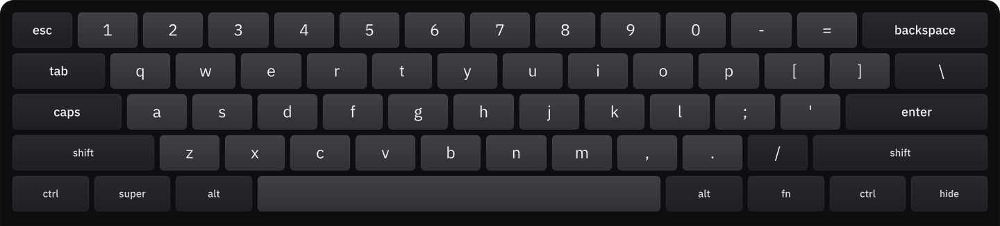
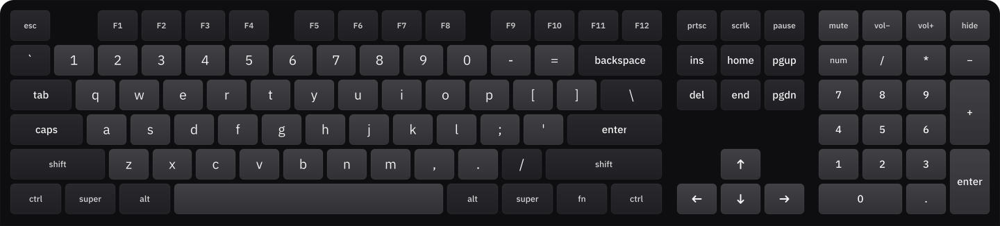

<div align="center">

# Touch Board

**The real on-screen keyboard for GNOME Shell.**<br>
_all **keys**, any **layout**, raw **input**_

**`layout profiles`** **`display scaling`** **`smart visibility`** **`evdev injection`** **`xkb tracking`** **`accent popups`** **`modifier modes`** **`fn layer`**


&nbsp;




</div>

>The stock OSK covers a search box and a password field. Touch Board is a full keyboard for writing, coding, and anything that needs working modifier keys, proper layout support and hardware-level evdev input. The panel button keeps it one tap away on any session, lock screen included.

Requires **GNOME Shell 50**.

## Highlights

- **Built for terminal work and coding.** Everything a physical keyboard has (modifier keys, function row, numpad, navigation) in a touch-native interface.
- **Hardware-level input.** Keys inject raw Linux evdev codes through a Clutter virtual device. The active xkb layout translates them. Key faces are cosmetic.
- **Three profiles.** Compact (60%) is the ANSI main block. Standard (75%) adds the F-row, navigation column, and arrow cluster. Full (100%) extends with a numpad. Each scales to fill the display width.
- **Modifier state machine.** Shift, Ctrl, Alt, Super, and AltGr each arm on lift. Tap for a one-shot (clears after the next key), hold to lock. Three modes: Hold, Latch (double-tap to promote to lock), Toggle. Armed glyph keys preview the shifted or AltGr level.
- **Fn layer.** A second layer of faces and codes over the entire board, engaged as one-shot or lock. On compact it restores the full nav cluster (F1-F12 on the number row, arrows and nav on UIOP / JKL;). On standard and full it turns F1-F12 into the media row.
- **Reassignable function row.** Each F1-F12 slot maps independently to volume, brightness, media transport, mic mute, navigation, or editing keys.
- **Live xkb tracking.** Subscribes to `InputSourceManager` directly. The gsetting lags under Wayland. Bundled glyph maps cover Western and Eastern European layouts plus US English (11 total). Unmapped sources fall back to US faces while injected codes stay correct.
- **CJK input via IBus.** Chinese (Pinyin), Japanese (Anthy), and Korean (Hangul) compose through `handleVirtualKey`. Ctrl/Alt/Super bypass the engine and take the raw evdev path. No engine installed: US faces and layout-neutral keysyms.
- **Accent popups.** Long-press a Latin letter to open a variant strip. 12 base letters, 50+ diacritics and symbols. Slide to select, or lift and tap. With accents off, long-press auto-repeats at the desktop cadence instead.
- **Numpad.** Full profile only. Digit and navigation faces on the same keys. A local Num key switches between them, independent of the system Num Lock.
- **Caps Lock sync.** Tracks the real system keymap state. Hardware toggles update the key face on the spot.
- **Window lift.** The focused window slides up by the keyboard height when the keyboard would cover its input. Caret position from the Wayland input method or IBus (X11/XWayland), with the window frame as fallback. Drag the window to release the lift.
- **Smart visibility.** Opens on text-input-v3 (cooperative apps and prompts), stage key-focus (overview search, auth dialogs), or the panel button. Auto-shows skip when a physical keyboard is attached, after hardware typing, or during the 3-second login settle. The panel button bypasses all of this, lock screen included.
- **Single-anchor scaling.** One root font-size from height-percent of the short display edge. Every key metric in em. A portrait width guard keeps the full layout on screen after rotation.
- **Customization.** Layout profile, height (18-60%), key spacing, glyph size (75-135%), modifier mode (Hold/Latch/Toggle), accent popup, engaged modifier colour, label case (upper/title/lower), corner style (sharp/soft/round), click sound (thock/click/tap/pop) and volume, key font, per-F-key remapping.

## Profiles

>Each profile is one continuous grid scaled to the display width. Fewer columns means bigger keys.

<details>
<summary><b>Compact (60%)</b>: the ANSI main block, nothing else</summary>



The Fn layer restores everything the 60% block drops: F1-F12 on the number row, nav and arrow cluster on `U I O P` / `J K L ;`, and forward Delete on Backspace.
</details>

<details>
<summary><b>Standard (75%)</b>: main block, F-row, navigation and arrows</summary>


Standard adds the function row, a navigation column (PgUp, PgDn, Home, End) and a dedicated arrow cluster. The default profile.
</details>

<details>
<summary><b>Full (100%)</b>: everything, plus a numpad</summary>



Standard, plus an Ins/Home/PgUp over Del/End/PgDn block, Print / ScrollLock / Pause with a media trio across the top, and a full numpad with dual digit-and-navigation faces.
</details>

## Install

### extensions.gnome.org

Search for **Touch Board** on [extensions.gnome.org](https://extensions.gnome.org/) and
toggle it on. This is the recommended route and brings automatic updates.

### From a release

Download `touch-board@d3z-the-dev.github.io.shell-extension.zip` from the
[latest release](https://github.com/d3z-the-dev/touch-board/releases/latest), then:

```sh
gnome-extensions install --force touch-board@d3z-the-dev.github.io.shell-extension.zip
gnome-extensions enable touch-board@d3z-the-dev.github.io
```

On Wayland, log out and back in before the shell will load it.

### From source

```sh
make install
```

Copies `src/` into your user extensions directory, compiles the schema, and enables the extension. On Wayland log out and back in.

```sh
make uninstall   # disable and remove
make enable      # enable an installed copy
make pack        # build the dist/ zip
```

## Keys

### Fn layer

The Fn key swaps each key's face and code without injecting its own code. Tap, hold and lock follow the configured modifier mode.

On compact, Fn restores the full nav cluster: F1-F12 on the number row, Esc becomes grave/tilde, `U I O P` and `J K L ;` become navigation and arrows, Backspace becomes forward Delete.

On standard and full, Fn turns F1-F12 into a media row: brightness, Mission Control, search, keyboard backlight, transport and volume. A function-row override always wins over Fn.

### Modifiers

A modifier engages on lift. While armed it wraps each keystroke (press modifier, tap target, release modifier), then drops one-shots and keeps locks.

| Mode   | Tap | Long press | Tap while engaged |
|--------|-----|------------|-------------------|
| Hold   | One keystroke | Locks across keys | Clears the lock |
| Latch  | Arms a one-shot for the next keystroke | (none) | Second tap within the double-tap window promotes to a lock, otherwise clears |
| Toggle | Flips a lock | (none) | Flips it off |

One-shots light in the engaged colour. Locks use a lighter shade of the same colour. Glyph keys preview the next keystroke level under an armed Shift or AltGr. Caps Lock mirrors the real system keymap and reflects hardware toggles.

### Numpad

Full profile only. Each key carries two faces: digit and navigation. The local Num key flips between them, independent of the system Num Lock. Mode survives a hide.

### Accents

Long-press a Latin letter to open the variant popup. Slide to a variant and release, or lift and tap. Selecting a variant replaces the base committed on press (Backspace + commit). With accents off, held keys auto-repeat instead.

## Layouts

The keyboard tracks `InputSourceManager` in real time. Glyph maps only pick which face to draw. The xkb layout translates injected evdev codes. A source with no map falls back to US faces, and typing still works.

| Layout       | Code |
|--------------|------|
| English (US) | `us` |
| English (UK) | `gb` |
| German       | `de` |
| French       | `fr` |
| Spanish      | `es` |
| Italian      | `it` |
| Portuguese   | `pt` |
| Czech        | `cz` |
| Polish       | `pl` |
| Ukrainian    | `ua` |
| Russian      | `ru` |

GNOME reports some sources under alternate ids: `cn` `jp` `kr` alias to `zh` `ja` `ko`.

CJK sources compose through an IBus engine installed separately:

| Layout   | Code | Mode | Engine |
|----------|------|------|--------|
| Chinese  | `zh` | 拼   | Pinyin |
| Japanese | `ja` | あ   | Anthy  |
| Korean   | `ko` | 한   | Hangul |

With an active engine, keystrokes go through `handleVirtualKey` instead of an evdev code. The `ja` and `zh` keys show Latin caps for romaji and pinyin. The `ko` keys show Dubeolsik jamo. Without an engine, CJK sources fall back to US faces and US-position keysyms.

## Showing and hiding

Three triggers open it:

- Cooperative apps and system prompts through text-input-v3 (touch sessions only).
- Shell-internal fields (overview search, auth dialogs) through stage key-focus.
- The panel button bypasses all gates and works on any session, lock screen included.

Auto-shows don't trigger while a physical keyboard is attached, after physical typing, or during a 3-second settle window after login.

While up, it lifts the focused window by its own height. Caret position from the Wayland input method or IBus (X11/XWayland), with the window frame as fallback. Dragging the window releases the lift.

## Preferences

Open with `gnome-extensions prefs touch-board@d3z-the-dev.github.io` or from the Extensions app.

- **Layout:** compact, standard, or full.
- **Key font:** glyph family. The default IBM Plex Sans chain falls back to system fonts for CJK, Arabic, Devanagari and other non-Latin scripts.
- **Engaged colour:** fill for one-shot and locked modifiers.
- **Label case:** upper, title or lower. F1-F12 always keep their capital F.
- **Rounded corners:** round or square the key corners and the keyboard's top edge.
- **Height:** percent of the display height, 18 to 60.
- **Modifier keys:** Hold, Latch, or Toggle.
- **Accent popup:** long-press for accents, or auto-repeat instead.
- **Key click:** synthesised click on each tap, with selectable sound and volume.
- **Function row:** reassign any F1-F12 to volume, brightness, media, mic mute, navigation or editing keys.

## Development

`src/` runs as plain GJS with no build step. Type-checking uses `@girs` GNOME definitions under `checkJs`. Linting is eslint.

```sh
git clone https://github.com/d3z-the-dev/touch-board
cd touch-board
npm install
make check   # tsc --noEmit
make lint    # eslint
make pack    # build the zip in dist/
```

CI runs the same checks on every push and attaches a built zip to each tagged release.

## Contributing

Open a pull request or issue. State the scope upfront.

### Features

**Missing functionality**: anything the stock OSK or comparable keyboards do that Touch Board does not. State what it is, where it exists, and why it belongs here.

**New functionality**: anything that fits a full hardware keyboard on a touchscreen. Describe the use case.

**New input types**: gesture typing, handwriting forwarded to IBus, stylus layout. Include a working prototype or a tight spec.

**Innovative features**: experimental or high-effort ideas. Tag the issue `proposal`, describe the idea and use case fully, and link a proof-of-concept fork if you have one. Work begins only after a maintainer decision.

**New layouts**: any xkb layout not in the shipped set. Format follows `src/lib/labels.js`. Include a verified glyph map and a reference source (keyboard photo or xkb file). A dynamic system that generates maps from the active xkb definition at runtime would replace the static table. We welcome that work.

### Bugs

Cover the full lifecycle: discovery, reproduction, fix, test. Missing any stage delays resolution.

Required: exact steps to reproduce from a fresh GNOME session, expected vs. actual behaviour, GNOME Shell version, Wayland or X11, device model, screen resolution and DPI scaling factor.

**CJK layouts** (`zh` `ja` `ko`): the keyboard only forwards keysyms. Composition happens inside the IBus engine and its post-installation configuration. Include the engine name and version, any custom settings, and whether the bug appears with or without an active engine. With no engine installed, CJK falls back to US faces. That is expected.

**Display, scaling, rendering**: include screen resolution, DPI scaling factor, monitor count, and whether the issue reproduces after a screen rotation or on a secondary display. Attach a screenshot or recording for visual artifacts.

With a fix, document the full chain: how you found the bug, what you changed, and how you tested it. No reproduction case means no safe merge.

## License

Touch Board ships under GPL-3.0-or-later. See [LICENSE](LICENSE) for the full text.

The documentation images in `docs/img/` are licensed under
[CC-BY-SA-4.0](LICENSES/CC-BY-SA-4.0.txt).
